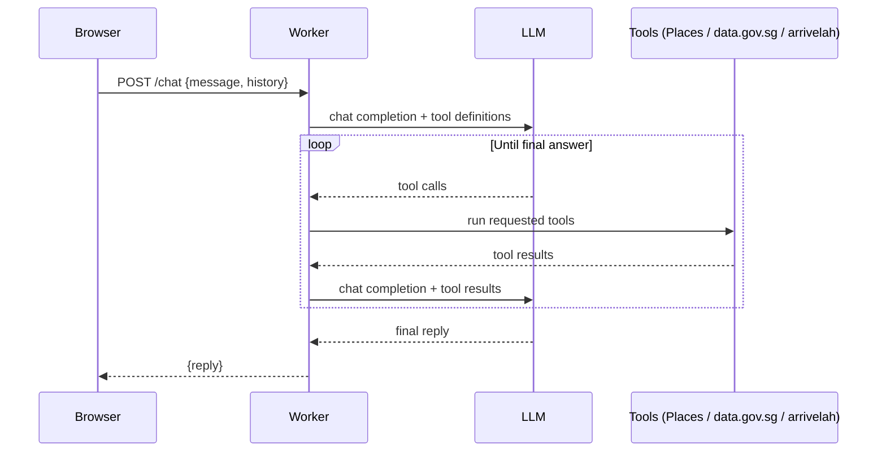

# Lunch Uncle

Lunch Uncle is a chatbot that tells you where to eat lunch near CT Hub 2, Lavender, Singapore. Uncle speaks casual Singaporean English, and he has strong opinions about where you should go.

## Architecture

Lunch Uncle runs as a single Cloudflare Worker. `src/index.js` routes requests: `GET /` serves the chat page from `src/ui.html`, `POST /chat` hands the turn to the agentic loop in `src/loop.js`, and `GET /geocode?q=` looks up a Singapore address, postal code or place name for the location picker. The loop calls an OpenAI-compatible chat completions endpoint, passing the tool definitions from `src/tools.js`. When the model asks for a tool call, the loop runs it, appends the result to the message list, and calls the model again. This repeats until the model gives a final answer with no more tool calls, up to 8 rounds and 45 seconds per turn. Tool calls in the same round run in parallel, and a tool that fails returns an error for the model to work around instead of failing the turn. `src/prompt.js` builds the system prompt that sets Uncle's persona and rules. The system prompt never changes between requests so the endpoint can cache it; the current Singapore time is added to each user message instead. There are three tools: `find_lunch_places`, which queries the Google Places API (New) Text Search, restricted to 800 m around the user's location and sorted nearest first; `get_rain_forecast`, which reads the two-hour forecast from data.gov.sg (no key needed); and `get_bus_arrivals`, which reads live arrivals from arrivelah (no key needed).

## Location and theme

Uncle assumes you are at CT Hub 2. Use **Change location** on the chat page to search for an address or postal code, or to share your current location from the browser. The location must be in Singapore. Place search, the rain forecast area and the nearest bus stops all follow it, and the browser remembers it. The **Theme** menu switches between System, Light, Dark, Kopi and Pandan, and is also remembered in the browser.

## Request flow



## Setup

1. Clone this repository.
2. Install dependencies:
   ```sh
   npm install
   ```
3. Create `.env` from `.env.example` and fill in your keys:
   ```sh
   cp .env.example .env
   ```
   ```
   OPENCODE_API_KEY=your-key-here
   GOOGLE_PLACES_API_KEY=your-key-here
   ```
4. Check the two constants at the top of `src/loop.js`: `LLM_BASE_URL` and `LLM_MODEL`. They are set for the OpenCode Go endpoint (`https://opencode.ai/inference/go/openai/v1`) and `glm-5.3`; change them to use another OpenAI-compatible provider. The Go endpoint uses the `x-opencode-session` header for prompt caching: the chat page sends one session id per conversation and `callModel` forwards it.
5. Start the dev server:
   ```sh
   npm run dev
   ```
   Open http://localhost:8787 and chat with Uncle.
6. To deploy, set the secrets on Cloudflare first, then deploy:
   ```sh
   wrangler secret put OPENCODE_API_KEY
   wrangler secret put GOOGLE_PLACES_API_KEY
   npm run deploy
   ```

Secrets never go in code or in `wrangler.toml`. Local development reads them from `.env`, which is gitignored; production reads them from Cloudflare secrets set with `wrangler secret put`.

## Running tests

```sh
npm test
```

This runs Node's built-in test runner. There are no test dependencies to install.

## Course key setup

For facilitators setting up a shared Google Places key for a course run:

1. In Google Cloud Console, create a new project for the course.
2. Enable **Places API (New)** only. Do not enable the legacy Places API.
3. Create an API key under APIs & Services → Credentials.
4. Under key restrictions, choose "Restrict key" and tick only Places API (New).
5. Go to APIs & Services → Places API (New) → Quotas, and cap requests per day to a modest number, such as 1,000.
6. In Billing → Budgets & alerts, create a budget with email alerts at 50% and 100%.

Treat the LLM key the same way: one key per course run, revoked once the course ends.

## Licence

MIT.
